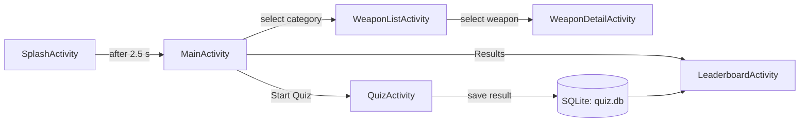

# Weaphones

> A bilingual (Hungarian / English) Android encyclopedia and quiz app about well-known firearms and infantry weapons, built as a university project.

> [!IMPORTANT]
> **Non-commercial university project.** This app was created solely for educational purposes as part of a university course. It is **not** published on Google Play or any other app store, is **not** distributed in any form (free or paid), and is **not** intended for commercial use. The source code is shared on GitHub only as a portfolio / reference project.
>
> The name "Weaphones" is also used by an unrelated application on the Google Play Store. This project has **no affiliation** with that app or its developer.

---

## Table of Contents

- [Overview](#overview)
- [Features](#features)
- [Tech Stack](#tech-stack)
- [Getting Started](#getting-started)
- [Project Structure](#project-structure)
- [Architecture & Navigation](#architecture--navigation)
- [Data Model](#data-model)
- [Localization](#localization)
- [Known Limitations](#known-limitations)
- [Disclaimer](#disclaimer)

---

## Overview

Weaphones is a native Android application written in Kotlin. It presents a catalogue of **40 weapons** grouped into **11 categories**, each with a picture and a short fact sheet (type, country of origin, manufacturer, year of introduction, caliber, weight, barrel length, rate of fire). A built-in quiz tests the user's knowledge of the catalogue, and past quiz results are stored locally.

The whole app works fully offline; all data is bundled with the application.

## Features

- **Splash screen** with fade-in / slide-up animations.
- **Category browser** – weapons are grouped into categories such as assault rifles, pistols, SMGs, machine guns, sniper rifles, shotguns, anti-tank weapons, grenade launchers and classic (WWII-era) weapons.
- **Weapon list** – each entry shows the name, caliber, country of origin and year at a glance.
- **Weapon detail page** – image and full fact sheet for the selected weapon.
- **Language switcher** – switch between Hungarian 🇭🇺 and English 🇬🇧 by tapping the flag icons on the main screen. The choice is persisted, so the app remembers it on the next launch (default: Hungarian).
- **Quiz**
  - 10 questions randomly drawn from a pool of 30 per language.
  - Two question types: text-only and image-based ("Which weapon is shown in the image?").
  - Questions cover country of origin, manufacturer, caliber, year of introduction and weapon identification.
  - Measures the time taken to complete the quiz.
- **Results history** – every finished quiz (score, total, duration, date) is saved to a local SQLite database and listed on the Results screen, newest first.


## Tech Stack

| Area | Technology |
|------|------------|
| Language | Kotlin 2.0.21 |
| UI | Android Views (XML layouts), Material Components (Material 3 DayNight theme) |
| Lists | `ListView` with `ArrayAdapter` / custom `BaseAdapter`, `RecyclerView` |
| Persistence | SQLite via `SQLiteOpenHelper` (quiz results), `SharedPreferences` (language setting) |
| Build | Gradle 8.13 (Kotlin DSL), Android Gradle Plugin 8.13.1, version catalog (`libs.versions.toml`) |
| SDK levels | `minSdk 24` (Android 7.0), `targetSdk 34`, `compileSdk 35` |
| JVM target | Java 11 |

## Getting Started

### Prerequisites

- [Android Studio](https://developer.android.com/studio) (a recent version that supports AGP 8.13)
- JDK 17 or newer to run the Gradle build (the JDK bundled with Android Studio is fine)
- An Android emulator or a physical device running Android 7.0 (API 24) or newer

### Build & run

1. Clone the repository:
   ```bash
   git clone https://github.com/DMilan05/Weaphones-language.git
   ```
2. Open the project folder in Android Studio and wait for the Gradle sync to finish.
3. Select an emulator or connected device and press **Run ▶**.

Alternatively, build a debug APK from the command line:

```bash
# macOS / Linux
./gradlew assembleDebug

# Windows
gradlew.bat assembleDebug
```

The APK will be generated at `app/build/outputs/apk/debug/app-debug.apk`.

## Project Structure

```
Weaphones-language/
├── app/
│   ├── build.gradle.kts
│   └── src/main/
│       ├── AndroidManifest.xml
│       ├── java/com/example/weaphones/
│       │   ├── SplashActivity.kt        # Animated launch screen
│       │   ├── MainActivity.kt          # Categories, language switcher, quiz & results buttons
│       │   ├── WeaponListActivity.kt    # Weapons of the selected category
│       │   ├── WeaponDetailActivity.kt  # Image + fact sheet of one weapon
│       │   ├── QuizActivity.kt          # Quiz logic and question pools (HU / EN)
│       │   ├── LeaderboardActivity.kt   # List of saved quiz results
│       │   ├── WeaponAdapter.kt         # Adapter for the weapon list
│       │   ├── LeaderboardAdapter.kt    # RecyclerView adapter for results
│       │   ├── WeaponData.kt            # Static weapon catalogue
│       │   ├── Weapon.kt                # Weapon data class
│       │   ├── QuizQuestion.kt          # Sealed class: Text / Image question
│       │   ├── QuizResult.kt            # Quiz result data class
│       │   ├── DatabaseHelper.kt        # SQLite helper for quiz results
│       │   └── LanguageManager.kt       # Persists and applies the selected locale
│       └── res/
│           ├── anim/                    # Splash animations
│           ├── drawable/                # Weapon images, flags, backgrounds
│           ├── layout/                  # Activity and list item layouts
│           ├── values/                  # Default (Hungarian) strings, colors, themes
│           └── values-en/               # English strings
├── gradle/libs.versions.toml            # Dependency version catalog
├── build.gradle.kts
└── settings.gradle.kts
```

## Architecture & Navigation

The app follows a simple multi-activity structure. Data is passed between screens via `Intent` extras.



## Data Model

### Weapon

Weapons are defined statically in `WeaponData.kt`. Category and country are stored as **string resource IDs**, so they are automatically displayed in the currently selected language.

```kotlin
data class Weapon(
    val name: String,
    val categoryRes: Int,     // R.string.cat_*
    val caliber: String,
    val originRes: Int,       // R.string.country_*
    val year: Int,
    val manufacturer: String,
    val weightKg: Double,
    val barrelLengthMm: Int,
    val rateOfFire: Int,      // rounds per minute
    val imageResId: Int       // R.drawable.*
)
```

### Quiz questions

```kotlin
sealed class QuizQuestion {
    data class Text(val question: String, val options: List<String>, val correctIndex: Int) : QuizQuestion()
    data class Image(val imageResId: Int, val question: String, val options: List<String>, val correctIndex: Int) : QuizQuestion()
}
```

### Quiz results (SQLite)

Results are stored in a local database named `quiz.db`:

| Column | Type | Description |
|--------|------|-------------|
| `id` | INTEGER PK AUTOINCREMENT | Row identifier |
| `correct` | INTEGER | Number of correct answers |
| `total` | INTEGER | Number of questions |
| `timeMillis` | INTEGER | Time taken to finish the quiz (ms) |
| `timestamp` | INTEGER | Completion time (epoch ms) |

## Localization

- `res/values/strings.xml` – Hungarian (default)
- `res/values-en/strings.xml` – English

`LanguageManager` stores the selected language code (`"hu"` or `"en"`) in `SharedPreferences` and applies the matching `Locale` before each activity's layout is inflated. Tapping a flag on the main screen saves the new language and recreates the activity.

UI labels, category names and country names come from string resources. Quiz questions are defined in two separate lists in `QuizActivity.kt`, and the list matching the current language is used.

To add a new language:

1. Create `res/values-<code>/strings.xml` with translated strings.
2. Add a flag icon and a click handler in `MainActivity` that calls `LanguageManager.setLanguage(this, "<code>")`.
3. Add a translated question pool in `QuizActivity` and select it based on the language code.

## Known Limitations

- The weapon catalogue and quiz questions are hard-coded; there is no remote data source or admin interface.
- Quiz questions are stored in Kotlin code rather than in resources, so each language needs its own question list.
- The Results screen shows the history of attempts in chronological order (newest first); it is not a ranked leaderboard.
- There are no user accounts; results are stored only on the device.

## Disclaimer

- This is a **university project** created for **educational purposes only**. It is not intended for commercial use and is not distributed through any app store or other channel; the source code is available only in this repository.
- This project is **not affiliated** with the similarly named "Weaphones" app on the Google Play Store.
- The app contains **general, encyclopedic information** (e.g. type, country of origin, year of introduction). The data was collected for learning purposes and may contain inaccuracies.
- Weapon images are used for **illustrative and educational purposes only** and remain the property of their respective owners. Product names, trademarks and brand names mentioned in the app belong to their respective owners.
